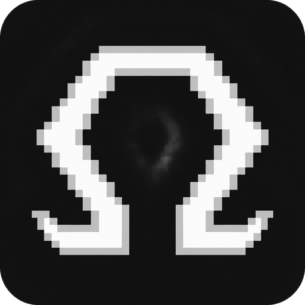

<div align="center">



# Ômega Notes

### Um espaço para escrever, estudar e conectar ideias.

Organize suas notas em um canvas visual, combine texto com imagens, áudios e vídeos
e mantenha seus arquivos no seu computador.


[**Baixar o aplicativo**](https://github.com/Zelchi/omega-notes/releases/latest) · [Novidades](changelog.md) · [Reportar um problema](https://github.com/Zelchi/omega-notes/issues)

</div>

---

## Suas ideias, conectadas

Uma nota nem sempre vive sozinha. Ela pode fazer parte de um assunto, complementar
uma leitura ou ajudar a entender outra ideia.

No Ômega Notes, suas notas aparecem como bolhas em um **canvas**. Você pode
movê-las, aproximar assuntos relacionados e navegar com zoom. As referências entre
notas aparecem como conexões, ajudando a visualizar como os conteúdos se relacionam.

Nas configurações, escolha entre **Estático**, para organizar as bolhas manualmente, e **Dinâmico**,
que distribui as notas automaticamente como pontos conectados pelas referências
`[[nota]]`. Os dois mostram as mesmas notas; alternar entre eles preserva a
organização manual. No Dinâmico, passe o mouse num ponto para destacar suas
conexões ou use o botão de enquadramento para ver o conjunto.

No Estático, as bolhas abrem espaço umas para as outras ao criar ou mover notas,
evitando sobreposições sem precisar reorganizar o canvas inteiro.

No modo de edição, arraste com o botão esquerdo numa área vazia para selecionar
várias notas e movê-las juntas. Use Ctrl ou Shift para ajustar a seleção e Escape
para desfazê-la. Arraste com o botão direito numa área vazia para mover o canvas.

Clique em uma bolha para abrir a nota e volte ao canvas quando quiser ver o conjunto.

## Converse com suas notas

Conecte um provedor de **IA** para
perguntar sobre suas notas, pedir resumos e explorar conexões entre assuntos.
Cada vault possui sua própria conversa e contexto. Você escolhe o modelo e pode
interromper a resposta quando quiser.

Ative **IA Features** nas configurações para exibir o ícone de chat na barra superior.
A opção vem desativada por padrão. O recurso consulta
os textos das notas e usa o serviço do provedor conectado, sujeito aos limites da sua
conta. Atualmente, o provedor disponível é o Codex, instalado no computador
e autenticado com sua conta ChatGPT. [Como conectar](docs/ai.md).

## Escreva do seu jeito

Use o modo de edição para construir suas notas e o modo de leitura para consultar
o conteúdo.

- **Títulos de H1 a H6** para organizar assuntos e seções.
- **Negrito e itálico** para destacar trechos.
- **Separadores** para dividir o conteúdo.
- **Alinhamento por parágrafo:** à esquerda, ao centro, à direita ou justificado. Sem seleção, a mudança vale para o parágrafo do cursor; com seleção, vale para os parágrafos selecionados.
- **Salvamento automático** durante a edição.

Você também pode conectar uma nota a outra usando referências no texto:

```text
[[Nome da nota]]
```

Para mostrar um nome diferente na referência:

```text
[[Nome da nota|Texto que será exibido]]
```

## Mais do que texto

Inclua materiais que ajudem a explicar, lembrar ou revisar um assunto.

| Conteúdo | O que você pode fazer |
| --- | --- |
| **Imagens** | Inserir, posicionar e redimensionar dentro da nota. |
| **Áudios** | Ouvir sem sair da nota, controlar a reprodução e ajustar o volume. |
| **Vídeos** | Assistir dentro da nota, avançar na reprodução, ajustar o volume e usar tela cheia. |
| **Catálogo de mídias** | Encontrar mídias da biblioteca e inseri-las nas notas. |

Importe arquivos pelo seletor ou arraste-os para o aplicativo.

## Separe seus assuntos em vaults

Um **vault** é uma biblioteca de notas e mídias. Crie bibliotecas diferentes para
separar matérias, projetos ou assuntos pessoais.

Você pode criar, renomear e alternar entre vaults. Cada um mantém suas próprias
notas e arquivos, com informações sobre quantidade de conteúdo e espaço utilizado.

## Encontre o que precisa

A busca procura nos **títulos e no conteúdo das notas**. Ela também considera
aproximações de palavras para ajudar quando você não lembra exatamente o que escreveu.

Selecione um resultado para abrir a nota correspondente.

## Deixe o aplicativo com a sua cara

Nas configurações, você pode escolher:

- **Tema claro ou escuro.**
- **Português do Brasil ou inglês.**
- **Cursor de linha ou de bloco**, com opções que piscam ou permanecem fixas.
- Escolher o canvas Estático ou Dinâmico.
- Centralizar o canvas ao iniciar.
- Exibir ou ocultar os botões do canto inferior direito do canvas.

## Seus arquivos ficam com você

As notas e mídias são armazenadas localmente, na pasta **Ômega Notes** dentro de
**Documentos**. Escrever e consultar suas notas não depende de uma conexão com a internet.

Para guardar uma cópia da sua biblioteca, copie essa pasta com o aplicativo fechado.

## Instalação

Abra a [página de versões](https://github.com/Zelchi/omega-notes/releases) e baixe
o pacote correspondente ao seu sistema. Os instaladores são para computadores **x64**.

| Sistema | Arquivo | Como instalar |
| --- | --- | --- |
| **Windows 10/11** | `.exe` | Abra o instalador e siga as instruções. |
| **Ubuntu 22.04 ou mais recente** | `.deb` | Abra com o instalador de pacotes ou use `sudo apt install ./arquivo.deb`. |
| **Fedora** | `.rpm` | Abra com o instalador de pacotes ou use `sudo dnf install ./arquivo.rpm`. |

Depois de instalar, crie um vault e sua primeira nota.

### Atualizações

O aplicativo verifica novas versões ao iniciar e informa no botão das configurações
quando uma atualização está disponível. O download e a instalação só começam
quando você clica nesse botão. Antes de instalar, o aplicativo conclui os salvamentos
pendentes e reinicia após a instalação. No Linux, a instalação pode solicitar a senha do sistema.

Você também pode usar **Verificar atualizações**, no final das configurações.
A conexão com a internet é necessária para verificar e baixar novas versões.

> A exportação para PDF está temporariamente desativada.

---

<div align="center">

**Encontrou um problema ou tem uma ideia?**

[Conte no GitHub](https://github.com/Zelchi/omega-notes/issues), incluindo uma descrição
e, quando possível, uma imagem do que aconteceu.

</div>
